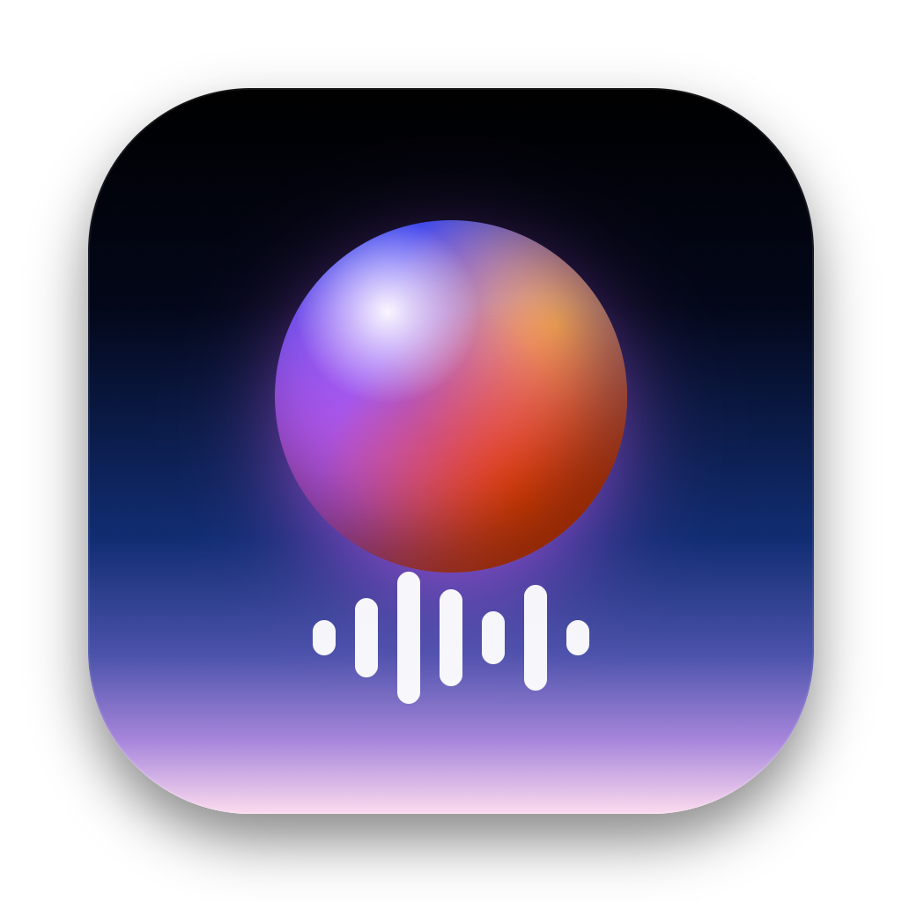

<p align="center"></p>

<h1 align="center">Aurora Voice</h1>

<p align="center">Ultra-low-latency real-time voice changer for macOS: anime characters, realistic human voices and 50 effects, live in Discord, games and calls.</p>

<p align="center"><b>Status:</b> in development · macOS first, Windows planned · not yet released</p>

---

## Features

- **28 character voices** across anime, realistic, dark and creature styles, each with an original portrait
- **49 effects**: robots, radios, caves, demons, pitch and formant tricks
- **Voice Lab**: stack effects in any order and tune them live
- **Soundboard** with keyboard triggers and custom clips
- **Hear myself** monitoring, noise gate, AI background-noise removal (RNNoise; 5 / 15 / 30 ms modes)
- **Live latency readout** straight from the audio device
- WebGL aurora interface with an audio-reactive sphere and scroll-driven motion
- Everything runs locally; no account, no cloud processing

## Run it (development)

Requirements: macOS, Node 20+, Python 3.11+, Xcode command-line tools, CMake. Virtual mic: Aurora Microphone (`drivers/aurora-hal/install.sh`) or [BlackHole 2ch](https://existential.audio/blackhole/).

```bash
pip3 install -r requirements.txt
npm install
npm run dev
```

Build the native engine first (`npm run build:native`, needs Xcode command-line tools and CMake). Electron starts `python/ws_server.py` (`ws://localhost:9001`), which drives the native engine; set `AURORA_ENGINE=python` to use the old Python engine. In Setup, send the changed voice to **Aurora Microphone** (or BlackHole 2ch), then pick it as the microphone in Discord, OBS, Zoom or your game.

Hotkeys: **F1** voice on/off · **F4** show/hide window.

## Project layout

| Path | What it is |
| --- | --- |
| `electron/` | Window, tray, menu, global hotkeys; spawns the engine |
| `drivers/aurora-hal/` | Aurora Microphone virtual mic driver (AudioServerPlugIn) ([details](drivers/aurora-hal/README.md)) |
| `native/aurora-core/` | Native C++ engine: CoreAudio HAL I/O, low-delay pitch/formant shifter, all voices ([details](native/aurora-core/README.md)) |
| `python/` | WebSocket control server, voice presets, ctypes bridge (`native_engine.py`), legacy Python engine |
| `src/gl/AuroraScene.js` | WebGL aurora background and audio-reactive sphere (three.js) |
| `src/lib/engine.js` | WebSocket store; meters and spectrum bypass React and feed the GL scene |
| `src/components/` | Live, Characters, Effects, Soundboard, Voice Lab, Setup, Dock |
| `src/assets/faces/` | Character portraits (`<voice id>.jpg`) |
| `website/` | Static landing page (no downloads yet) |
| `tools/` | Icon renderer, portrait sheet splitter, voice list exporter |

## Roadmap

1. ~~**Measure**: loopback latency test~~ (native engine measures it with host timestamps)
2. ~~**Native engine**: CoreAudio + C++~~ (done: ~8–12 ms after the mic at 64-frame buffers, all 77 voices)
3. ~~**Own virtual mic**~~ (Aurora Microphone driver built and tested; BlackHole remains a fallback)
4. ~~**Neural voices**~~ (streaming ONNX models on a real-time worker; first voice: LLVC, ~26–30 ms added)
5. **Own streaming model** with licensed voice-actor data and quality tiers
6. Windows build (WASAPI, virtual mic driver)

Measured on a MacBook Air M2 into BlackHole: 38–42 ms end to end, of which ~31 ms is the built-in mic's own reported latency. A USB or interface mic avoids most of that.

## Licence

Proprietary. All rights reserved. See [LICENSE](LICENSE).
