<p align="center">
  
</p>

<p align="center">
  
  
  
  
  
</p>

<p align="center">
  <b>A real-time voice changer for Mac.</b> 80 voices, from on-device AI voices and anime characters to robots and radios,<br/>
  with background noise removal, a soundboard for your own clips and its own virtual microphone.
</p>

<p align="center">
  <a href="https://aurora-voice-eosin.vercel.app"><b>Website</b></a> ·
  <a href="docs/media/tour.mp4"><b>Watch the tour</b></a> ·
  <a href="#-quick-start"><b>Quick start</b></a> ·
  <a href="#-how-its-built"><b>How it's built</b></a> ·
  <a href="#-latency"><b>Latency</b></a>
</p>

<p align="center">
  <a href="docs/media/tour.mp4">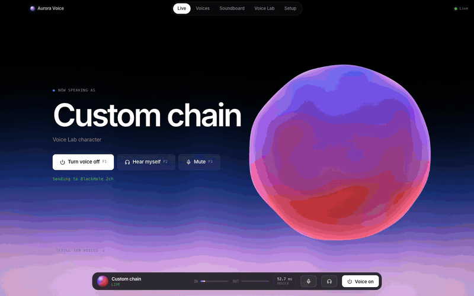</a>
  <br/><sub>▶ <a href="docs/media/tour.mp4">Full-quality tour video (MP4, 27 s)</a></sub>
</p>

---

## ✨ Highlights

<table>
  <tr>
    <td width="33%" valign="top">
      <h3>🎭 80 voices with faces</h3>
      AI voices, anime heroes, villains, real people and 49 effects. Every one has its own hand-built vector portrait. Search, filter and star favourites.
    </td>
    <td width="33%" valign="top">
      <h3>⚡ ~10 ms engine</h3>
      Native C++ on CoreAudio with 1.3 ms buffers. A low-delay spectral shifter moves pitch and formants separately, so voices sound like people.
    </td>
    <td width="33%" valign="top">
      <h3>🧠 AI voices on device</h3>
      Streaming neural voice conversion (ONNX Runtime) on a real-time worker. Nothing leaves your Mac.
    </td>
  </tr>
  <tr>
    <td valign="top">
      <h3>🔇 Noise removal</h3>
      Keyboards, fans and traffic fade out before the voice is changed. Three modes: <b>Low latency</b> +5 ms, <b>Balanced</b> +15 ms, <b>Studio</b> +30 ms.
    </td>
    <td valign="top">
      <h3>🎛️ Soundboard, your sounds</h3>
      Upload or drag in MP3, WAV, M4A, AAC, AIFF or FLAC (up to 2 min). Each pad gets a global hotkey, volume and loop. You hear them too.
    </td>
    <td valign="top">
      <h3>🎙️ Its own virtual mic</h3>
      <b>Aurora Microphone</b> is a CoreAudio driver that shows up in Discord, OBS, Zoom and games. BlackHole works as a fallback.
    </td>
  </tr>
  <tr>
    <td valign="top">
      <h3>⏺️ Recorder</h3>
      Record what your call hears, or <b>Mac audio</b> from any app (YouTube, games). Streams to WAV for up to 30 minutes.
    </td>
    <td valign="top">
      <h3>⏪ Instant Replay</h3>
      The last 10, 30 or 60 s stay in memory. Press <kbd>F5</kbd> after something happens and it's saved, even mid-game.
    </td>
    <td valign="top">
      <h3>✂️ Clip to soundboard</h3>
      Preview any recording, trim it on its waveform and turn it into a soundboard pad in one click.
    </td>
  </tr>
</table>

<p align="center">
  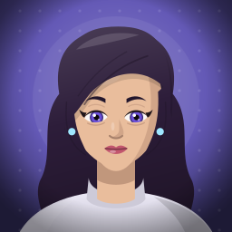
  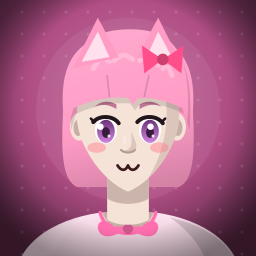
  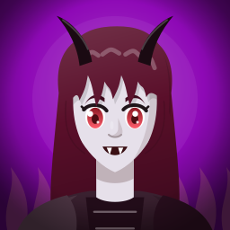
  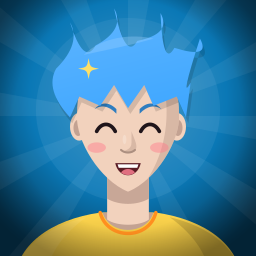
  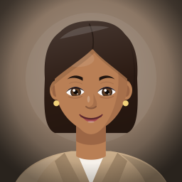
  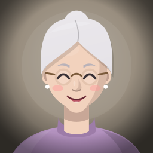
  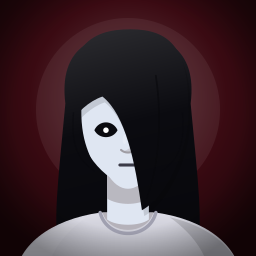
  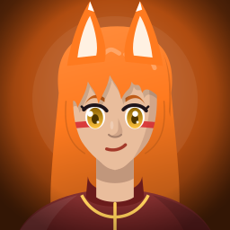
  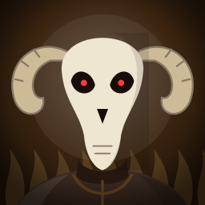
  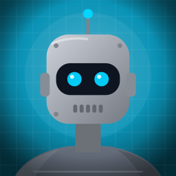
  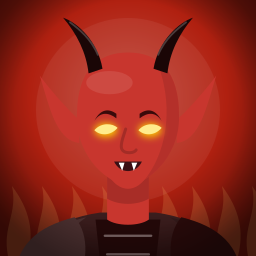
  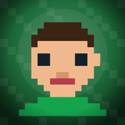
</p>

## 📸 A look inside

<table>
  <tr>
    <td width="50%" valign="top">
      
      <p><b>Live:</b> the active voice, mic meter, mute (F3) and the latency your call actually hears. The portrait changes as you switch voices.</p>
    </td>
    <td width="50%" valign="top">
      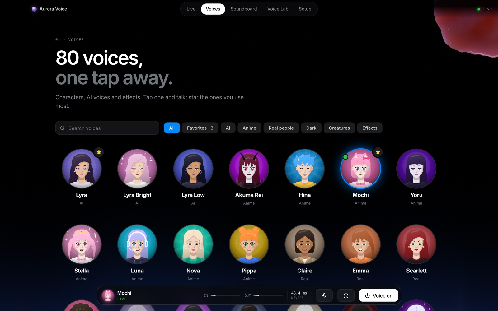
      <p><b>Voices:</b> one library for characters, AI voices and effects. Search, filter by All, Favorites, AI, Anime, Real people, Dark, Creatures or Effects, and star the ones you use.</p>
    </td>
  </tr>
  <tr>
    <td valign="top">
      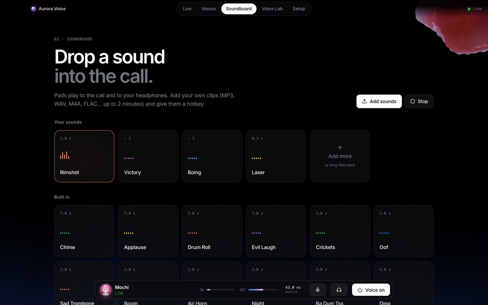
      <p><b>Soundboard:</b> upload with the button or drop files anywhere on the page. Each pad's menu handles rename, volume, loop, a hotkey and delete.</p>
    </td>
    <td valign="top">
      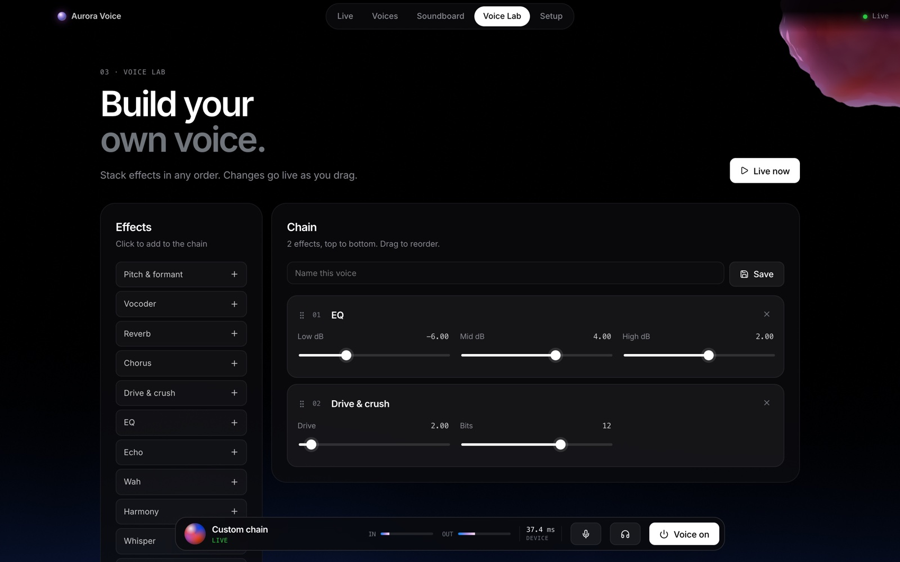
      <p><b>Voice Lab:</b> stack 13 effects in any order, from pitch and formant to vocoder, harmony, autotune and radio noise. Tune them while you talk, then save the result as your own voice.</p>
    </td>
  </tr>
  <tr>
    <td valign="top">
      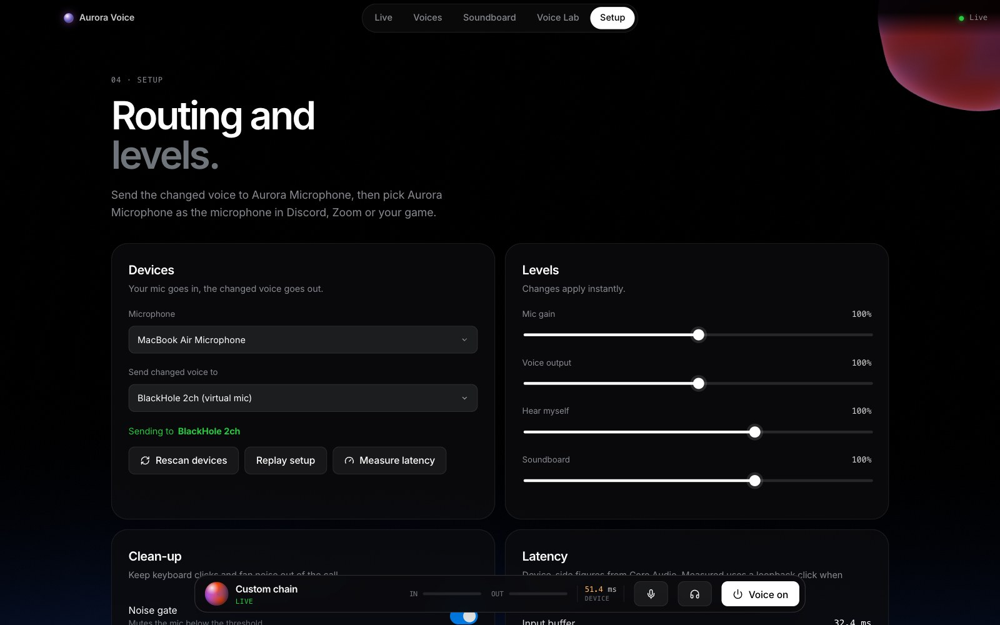
      <p><b>Setup:</b> pick the mic, send the voice to Aurora Microphone, turn on noise removal and measure the real latency with one click.</p>
    </td>
    <td valign="top">
      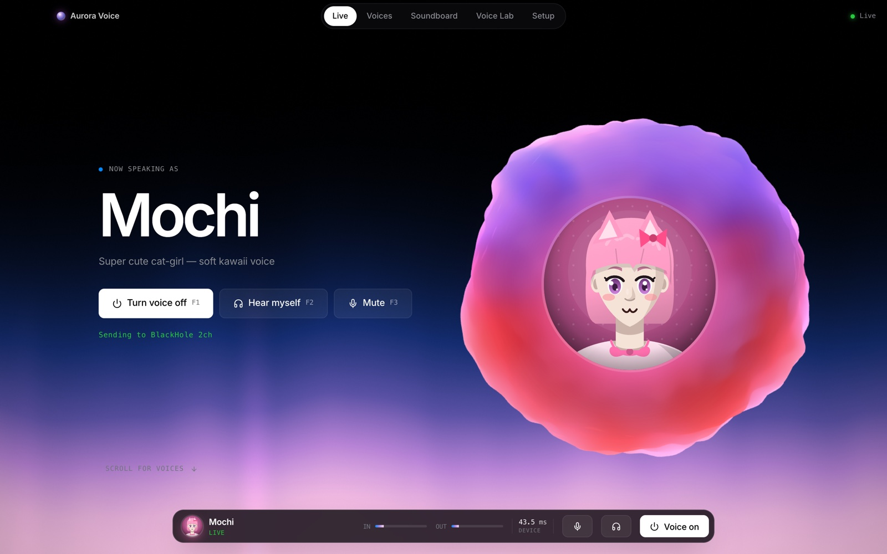
      <p><b>Interface:</b> a WebGL aurora with an audio-reactive sphere and scroll-driven motion, built with React, three.js and Framer Motion.</p>
    </td>
  </tr>
</table>

<details>
<summary><b>🖼️ All 80 portraits</b></summary>
<br/>
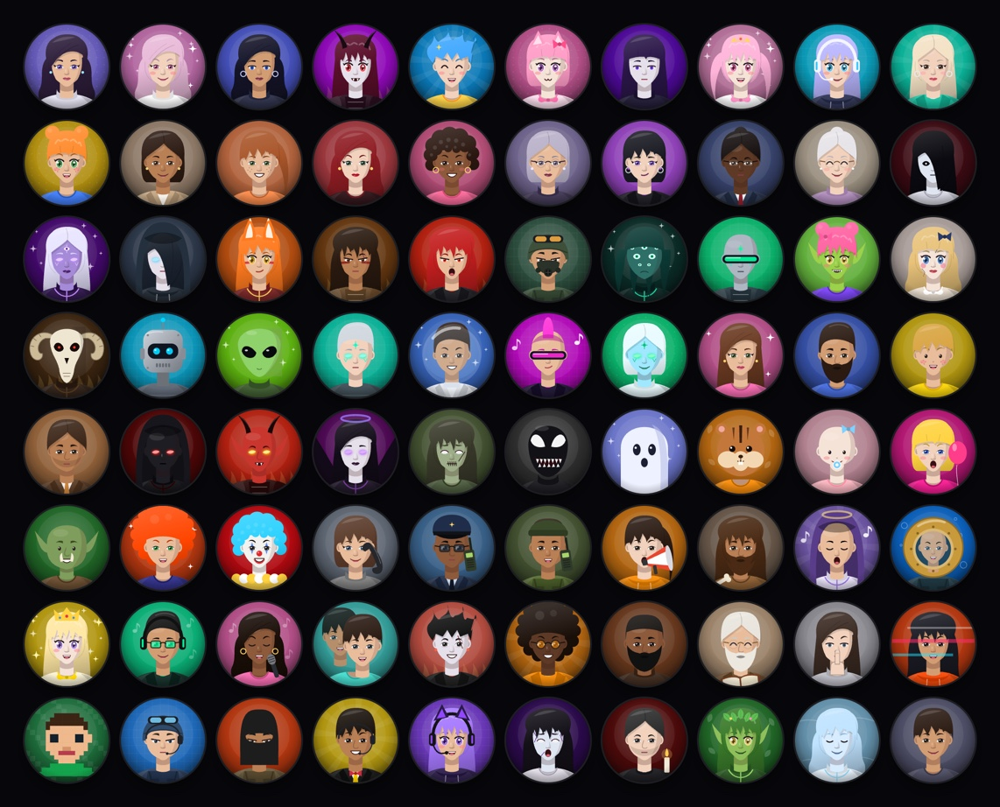

Portraits are drawn in code from a small vector kit (layered head, hair, eyes and props with two-tone shading). No image generation is involved. Regenerate them with `node tools/avatars/generate.mjs`.
</details>

## 🚀 Quick start

**Needs:** macOS on Apple Silicon, Node 20+, Python 3.11+, Xcode command-line tools and CMake.

```bash
pip3 install -r requirements.txt   # websockets, numpy, onnxruntime…
npm install
npm run build:native               # C++ engine → native/aurora-core/build/libaurora_core.dylib
npm run build:driver               # Aurora Microphone driver + its tests
drivers/aurora-hal/install.sh      # install the virtual mic (asks for your password, restarts Core Audio)
npm run dev                        # Vite + Electron
```

In **Setup**, choose your microphone and send the voice to **Aurora Microphone** (or [BlackHole 2ch](https://existential.audio/blackhole/)). Then pick *Aurora Microphone* as the mic in Discord, OBS, Zoom or your game.

<details>
<summary><b>AI voices (optional)</b></summary>
<br/>

The AI voices use [LLVC](https://github.com/KoeAI/LLVC) (MIT), exported to a streaming ONNX model:

```bash
pip3 install torch onnx
git clone https://github.com/KoeAI/LLVC
curl -L -o G_500000.pth https://huggingface.co/KoeAI/llvc/resolve/main/models/checkpoints/llvc/G_500000.pth
python3 native/aurora-core/tools/llvc/export_llvc.py --llvc-src LLVC --checkpoint G_500000.pth --out models/llvc/llvc.onnx
```

Without the model the AI voices are hidden and everything else works. Microsoft's `onnxruntime` pip build runs a step in about 4 ms, about 1.5× faster than Homebrew's, and the engine picks it up automatically.
</details>

### ⌨️ Hotkeys

| Key | Action |
| --- | --- |
| <kbd>F1</kbd> | Voice on / off |
| <kbd>F2</kbd> | Hear myself |
| <kbd>F3</kbd> | Mute the mic |
| <kbd>F4</kbd> | Show / hide the window |
| <kbd>F5</kbd> | Save instant replay |
| <kbd>F6</kbd> | Start / stop recording |
| Your choice | Any soundboard pad (e.g. <kbd>⇧</kbd> <kbd>1</kbd>), global in the desktop app |

## 🏗️ How it's built

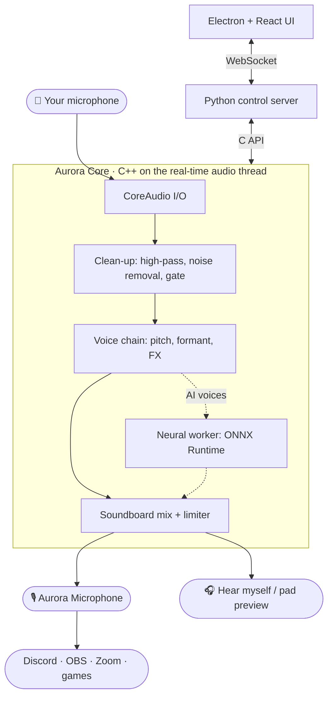

- **I/O:** CoreAudio IOProcs directly, no PortAudio. Input and output on different clocks are bridged by a lock-free ring with drift-correcting resampling, which keeps Bluetooth and iPhone mics glitch-free.
- **Pitch and formant:** a low-delay spectral shifter (Mauler-Martin asymmetric windows, 5.33 ms) with a peak-locked phase vocoder and a cepstral envelope, so pitch and formants move independently.
- **Voice changes** are built off the audio thread, swapped atomically and crossfaded over 12 ms. Old chains are freed off the audio thread.
- **Noise removal:** RNNoise 0.2 (BSD-3), with a gain-only API added so it can run in low-delay modes.
- **AI voices:** a streaming ONNX model on a Mach real-time worker, fed through band-limited resamplers with a fixed lead, so latency stays constant.
- **Recorder and Instant Replay:** each source writes into an ~85 s lock-free history ring. Replay copies the last N seconds out; the recorder thread streams the ring to WAV every 40 ms. **Mac audio** comes from a Core Audio process tap (macOS 14.2+) that leaves Aurora's own output out. The app asks for System Audio Recording permission before creating the tap, because an undecided prompt would stall Core Audio for the whole process.
- **Aurora Microphone:** an AudioServerPlugIn with zero added latency, sample-time-indexed loopback, and silence instead of stale audio. It never becomes the default output, so system sounds can't leak into calls.

Deep dives: [engine](native/aurora-core/README.md) · [virtual mic](drivers/aurora-hal/README.md)

## ⏱️ Latency

Measured with a loopback click through the whole chain on a MacBook Air M2, 64-frame buffers, no dropouts:

| Microphone | Effect voice | AI voice |
| --- | ---: | ---: |
| MacBook Air built-in mic | 42 ms | 62 ms |
| AirPods Pro (Bluetooth) | 43 ms | 64 ms |

The engine itself adds **~8–11 ms** for effect voices. The built-in mic reports 31 ms of its own, so a USB or audio-interface mic is much faster. Noise removal adds 5.3, 15.3 or 30 ms depending on the mode.

| Noise removal mode | Added latency | Noise reduction (SI-SDR gain) |
| --- | ---: | ---: |
| Low latency | 5.3 ms | +3.5 dB |
| Balanced (default) | 15.3 ms | +5.2 dB |
| Studio | 30.0 ms | +6.0 dB |

## 🧪 Testing

```bash
npm test
```

Runs everything:

1. **Native benchmark:** about 100 checks on the FFT, pitch accuracy (±2.2 cents), formants, resampler (77 dB SNR), denoiser and every preset.
2. **Driver tests:** loads the bundle the way `coreaudiod` does and checks sample-exact loopback.
3. **Recorder on real devices:** a pad played through the live engine must come back sample-for-sample in instant replay and in a recording.
4. **Live end-to-end test:** drives the real server over WebSocket with real devices. It covers voices, mute, noise modes, sound uploads (WAV/AAC, bad files rejected), rename/volume/loop/hotkey, looping, stop, delete, recording, instant replay, trimming a recording into a pad, and a loopback latency check.
5. **UI build.**

Use `E2E_MIC=airpods npm test` to run the live test on another microphone.

## 🗂️ Project layout

| Path | What it is |
| --- | --- |
| `native/aurora-core/` | C++ engine: CoreAudio I/O, DSP, noise removal, neural worker, C API, tests |
| `drivers/aurora-hal/` | Aurora Microphone virtual mic (AudioServerPlugIn) |
| `python/` | WebSocket control server, voice presets, sound library, recorder, ctypes bridge |
| `electron/` | Window, tray, menu, global hotkeys; starts the engine |
| `src/` | React UI: Live, Voices, Soundboard, Voice Lab, Setup; WebGL scene in `src/gl/` |
| `src/assets/avatars/` | The 80 voice portraits (SVG) |
| `tools/avatars/` | Vector portrait kit and generator |
| `tools/media/` | Screenshot and tour-video capture for this README |
| `tests/` | Live end-to-end test and the `npm test` runner |
| `website/` | Landing page ([live](https://aurora-voice-eosin.vercel.app)) |

## 🗺️ Roadmap

- [x] Loopback latency measurement
- [x] Native C++ engine on CoreAudio
- [x] Aurora Microphone virtual mic
- [x] Streaming AI voices on device
- [x] Background noise removal
- [x] Voice library with portraits, search and favourites
- [x] Soundboard with custom uploads and global hotkeys
- [x] Saved Voice Lab voices
- [x] Recorder and Instant Replay (your voice or Mac audio), trim to soundboard
- [ ] Our own streaming voice model with licensed voice-actor data
- [ ] Signed and notarised release (Developer ID)
- [ ] Windows (WASAPI and a virtual mic driver)

## 📄 Licence

Proprietary. All rights reserved. See [LICENSE](LICENSE). Third-party components keep their own licences: RNNoise (BSD-3) and LLVC (MIT).
